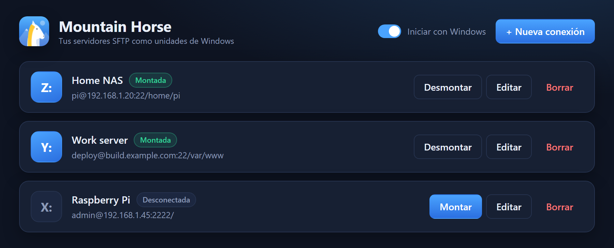
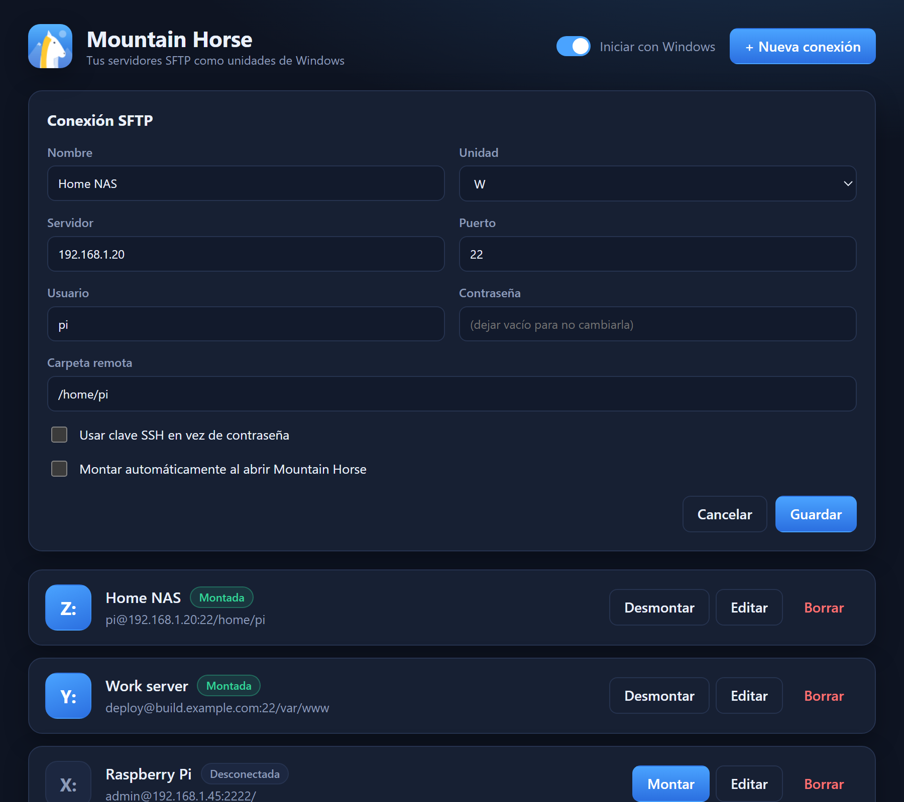

<p align="center">
  
</p>

<h1 align="center">Mountain Horse</h1>

<p align="center">
  Mount your SFTP servers as Windows drive letters.<br>
  A small, free alternative to Mountain Duck, built with Tauri and SSHFS-Win.
</p>

<p align="center">
  
</p>

> [!WARNING]
> **This is a vibe-coded app.** Mountain Horse was written almost entirely by an AI assistant (Claude Code) through conversation, with a human directing the work and testing it on a single Windows PC. It has not had a security audit or broad testing. It handles server passwords and mounts remote file systems, so review the code and use it at your own risk, ideally not on critical servers yet. Issues and pull requests are welcome.

## Features

- **Drive letters for SFTP**: servers show up in Explorer as `Z:`, `Y:`, ... and work with any app.
- **Read and write**: files are owned by your Windows user, so you can create, edit and delete.
- **Password or SSH key** login. Passwords are stored in Windows Credential Manager, never in a file.
- **Tray icon**: closing the window keeps your mounts alive; mount and unmount from the tray menu.
- **Auto-mount** chosen connections when the app starts, and **start with Windows**.
- **One installer**: it also installs [WinFsp](https://winfsp.dev/) and [SSHFS-Win](https://github.com/winfsp/sshfs-win) if they are missing.
- Light and dark theme that follow Windows.

## Install

1. Download `Mountain.Horse_x.y.z_x64-setup.exe` from the [latest release](../../releases/latest).
2. Run it (it asks for administrator rights because it installs WinFsp and SSHFS-Win).
3. Open **Mountain Horse** from the Start menu.

Requires Windows 10 or 11 (64-bit).

## Use

1. Click **+ New connection** (*Nueva conexión*).
2. Enter a name, the drive letter, host, port, user and password (or choose an SSH key).
3. Optionally set a remote folder (empty means the server root) and tick auto-mount.
4. Save, then press **Mount** (*Montar*). The drive appears in Explorer.

<p align="center">
  
</p>

The interface is currently in Spanish.

More detail is in [docs/USAGE.md](docs/USAGE.md) and [docs/TROUBLESHOOTING.md](docs/TROUBLESHOOTING.md).

## How it works

Mountain Horse does not implement SFTP itself. For each connection it starts `sshfs.exe` from SSHFS-Win, which uses WinFsp to present the remote folder as a drive. It passes `-ouid=-1,gid=-1` so the files are owned by your Windows account; mounting through `net use` leaves them owned by an unknown user and read-only on some accounts (for example Microsoft or Azure AD accounts). The password goes to `sshfs` over stdin, not on the command line.

See [docs/ARCHITECTURE.md](docs/ARCHITECTURE.md).

## Build from source

Requirements: Node.js 20+, the Rust toolchain (MSVC), and WebView2 (included with Windows 11).

```powershell
npm install
npx tauri icon app-icon.png          # generates src-tauri/icons (gitignored)
# put the WinFsp and SSHFS-Win MSIs in src-tauri/resources/ as winfsp.msi and sshfs-win.msi
npx tauri build                      # installer in src-tauri/target/release/bundle/nsis
```

The GitHub Actions workflow in `.github/workflows/build.yml` does exactly this and publishes a release when you push a `v*` tag.

## Security

- Passwords are kept in Windows Credential Manager (service `SftpDrive`).
- Host keys are not verified (`StrictHostKeyChecking=no`), as SSHFS-Win does by default. Use it on networks you trust.
- SSH keys with a passphrase are not supported.

## About this project

Mountain Horse is a vibe-coded project: the Rust backend, the interface, the installer scripts, the CI workflow, the screenshots and this documentation were produced with an AI coding assistant (Claude Code) from natural-language instructions. A human decided what to build, ran it on their own machine, and reported what worked and what did not. Expect rough edges, and read the code before trusting it with anything important.

## Credits

[WinFsp](https://winfsp.dev/), [SSHFS-Win](https://github.com/winfsp/sshfs-win) and [Tauri](https://tauri.app/).
